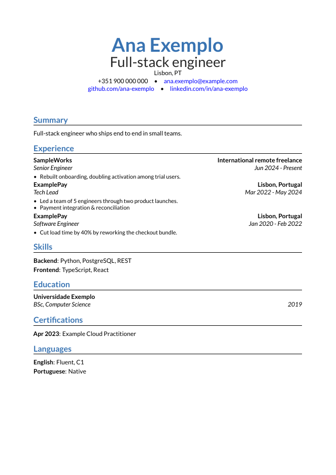
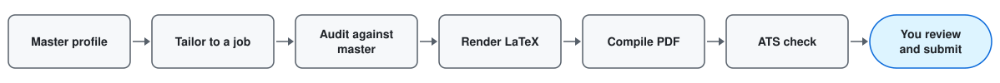

# cv-forge

cv-forge is a job-search copilot. It keeps one master profile of everything you have done and turns it into an honest, ATS-checked LaTeX CV and cover letter for each real job posting. You always click submit yourself.



## The problem

Searching for a job today means doing the same chores over and over:

- Reformatting your CV for every posting, then wondering whether an applicant tracking system (ATS) can even read the PDF.
- Writing for AI screening filters that reject candidates on keywords and layout quirks before a person looks at them.
- Retyping the same details into every application form.
- Spending time on ghost jobs: postings that are stale, never filled, or never meant to be.

cv-forge removes the mechanical part of this work and keeps the judgment with you.

## What works today (Phase 1)

Phase 1 is the foundation: from a master profile to a checked PDF.

- One master YAML profile holds every job, project, achievement and skill, with stable ids.
- A tailored selection picks which items to show for a given role and may reword their text. Job titles, employers and dates always come from the master; the tailored file only refers to them by id.
- An audit step checks the tailored file against the master: every id must exist, every number in a reworded bullet must appear in its source highlight (numbers in the summary and letter must appear in the master), every skill keyword must be a keyword of that skill in the master, and confidential terms listed in the master are blocked.
- Before anything is compiled, every rendered field, including those taken from the master (employer names, titles, institutions, contact links), is scanned for confidential terms; `build` and `master-cv` stop on a match.
- A LaTeX renderer produces a CV and a matching cover letter, in English, Brazilian Portuguese or European Portuguese.
- A compile step builds the PDFs, and an ATS check verifies the result: the page limit (CV at most 2 pages, letter exactly 1), a clean text layer (no unmapped glyphs or replacement characters), required text present (the CV must contain your name, the summary opening and every contact item; the letter must contain your name), section headings in order, and date ranges joined by an ASCII hyphen. Layout checks fail the build on orphaned entry headers, stranded section headings, holes in a page, pages that end early and text colliding with the footer; a thin last page is reported as a note only, since a CV of one and a half pages is fine.
- Privacy guards run as git hooks and in CI, so personal data stays out of the repository.

Commands:

```
cvforge validate <master>                      check a master profile against the schema
cvforge audit <tailored> --master <master>     compare a tailored CV with the master
cvforge build <tailored> --master <master>     audit, render, compile and ATS-check
cvforge master-cv <master> --lang en           render a full CV straight from the master
cvforge guard staged | tree | msg <file>       privacy checks used by the hooks and CI
```

## Apply flow (Phase 2)

Phase 2 turns one job posting into everything you need to apply. Python does the deterministic steps; the Claude commands `/apply` and `/outcome` (in `.claude/commands/`) drive them and write the two YAML files in between.

- **Intake:** `cvforge intake <link>` or `cvforge intake - --company X --role Y` with pasted text on stdin saves the posting under `data/applications/<slug>/` and adds a tracker row. A posting guard flags stale or suspicious text. LinkedIn links are refused: paste the text instead. A posting that is already tracked exits with 3.
- **Eligibility:** Claude records what the posting says (years, location, sponsorship, pay, languages) in `requirements.yaml`, each fact with a quote. `cvforge check <slug>` verifies every quote appears verbatim in the posting, then compares the facts with your preferences in the master profile. Exit 2 means skip; `--override "reason"` continues and records why. Caveats (hiring model such as CLT via an Employer of Record, time zone overlap, travel) print as `INFO` lines and never skip; `WARN uncaptured` flags posting sentences about residence, eligibility, overlap or travel that no quote covers.
- **Companies:** `cvforge company add | sponsor | show` keeps a registry with visa sponsor marks and their sources.
- **Salary:** `cvforge salary <slug>` suggests an expected salary from the posting range, an optional market CSV (see `examples/salary/market.template.csv`) and your pay floor, converted with ECB rates cached per day. `--confirm [AMOUNT]` locks it in.
- **Answers:** `cvforge answers <slug>` looks up screening answers in the answer bank and your knock-out facts; `--save` audits the tailored file and stores its answers.
- **Kit:** `cvforge kit <slug>` writes `kit.json` and a copy-ready `kit.html` with your details, work history cut to common field limits, salary, answers, the email to send when you apply by email, and links to the PDFs.
- **Tracker:** `cvforge track add | status | stage | done | show` records stages and follow-ups, and `cvforge due` lists what needs attention. `/outcome` records a result and what you learned.

A full run on the example persona, with no network:

```bash
cat examples/persona/posting.txt | cvforge intake - --company "Example Corp" --role "Senior Full-stack Engineer"
cp examples/persona/requirements.yaml data/applications/example-corp-senior-full-stack-engineer/
cvforge check example-corp-senior-full-stack-engineer --master examples/persona/master.yaml
cp examples/persona/tailored.yaml data/applications/example-corp-senior-full-stack-engineer/
cvforge build data/applications/example-corp-senior-full-stack-engineer/tailored.yaml \
  --master examples/persona/master.yaml --out data/applications/example-corp-senior-full-stack-engineer/
cvforge salary example-corp-senior-full-stack-engineer --master examples/persona/master.yaml
cvforge kit example-corp-senior-full-stack-engineer --master examples/persona/master.yaml
cvforge track status example-corp-senior-full-stack-engineer applied
cvforge due
```

`tests/test_apply_e2e.py` runs the same sequence. The human still clicks submit.

## Flow



## Roadmap

| Phase | Scope | Status |
| --- | --- | --- |
| 1 | Foundation: master profile, tailoring, audit, LaTeX CV and letter, ATS check, privacy guards, CI | Done |
| 2 | Apply flow: job link or pasted text, eligibility check, company registry with visa sponsor marks, salary suggestion, answer bank, copy-ready kit page, tracker with stages and a due view | Done |
| 3 | Firefox extension: fills job forms from the kit, never on linkedin.com, never submits | Planned |
| 4 | Discovery and company watchlist: job sources, Strider and Gupy tracking, ghost-job filter | Planned |
| 5 | Feedback loop: email sync for replies, an application report and follow-up reminders | Planned |
| 6 | A clean local web UI to track every application and run cv-forge without the command line | Planned |

## Quick start

Requires Python 3.10 or newer and a LaTeX setup (see below).

```bash
git clone <this repository> cv-forge && cd cv-forge
python3 -m venv .venv && source .venv/bin/activate
pip install -e '.[dev]'
git config core.hooksPath .githooks        # enable the privacy hooks

cvforge validate examples/persona/master.yaml
cvforge build examples/persona/tailored.yaml \
  --master examples/persona/master.yaml --out out/
```

`examples/persona` is a fictional candidate, "Ana Exemplo", with an English selection (`tailored.yaml`) and a Brazilian Portuguese one (`tailored.pt-BR.yaml`). The build writes a CV PDF and a cover letter PDF to `out/` and prints the result of the ATS check for each. Without `--out`, `build` writes next to the `tailored.yaml` (the application folder `intake` created) and `master-cv` to `data/review/`.

To use your own data, copy the persona files into `data/profile/` and edit them. That directory is ignored by git.

## LaTeX setup

The templates need LuaLaTeX for the CV and XeLaTeX for the letter, plus the `moderncv` class and `fontawesome5`.

Fonts ship with the package, so there is no extra font install. The CV is set in Lato and the cover letter uses Lato with some Raleway, so the two look alike and render evenly on screen. Both families are SIL OFL, and their licence files are included next to the font files. Both templates load them with `fontspec` from a relative path inside the build directory.

- **Linux:** install a current TeX Live (the [official installer](https://tug.org/texlive/) or the `texlive/texlive` Docker image). Distribution packages can lag a year or more behind; the CV header needs a recent `moderncv`.
- **CI:** the PDF job runs inside the official `texlive/texlive` image, pinned by digest, so it uses the same current packages as a local install.
  `poppler-utils` provides `pdftotext`, which the ATS check uses.
- **Windows:** install MiKTeX and run cv-forge from WSL. cv-forge calls the Windows engines (`lualatex.exe`, `xelatex.exe`), which can only write to Windows drives, so the build directory must be under `/mnt` (for example `/mnt/d/cv-forge-build`). The defaults assume MiKTeX in `D:\MiKTeX`; anywhere else, set the engine paths and the build directory as described in [Configuration](#configuration).

## Configuration

Settings come from environment variables first, then the `[cvforge]` table of `cvforge.toml` at the repository root (ignored by git), then the defaults.

| Key in `cvforge.toml` | Environment variable | Default |
| --- | --- | --- |
| `data_dir` | `CVFORGE_DATA_DIR` | `data/` in the repository |
| `build_dir` | `CVFORGE_BUILD_DIR` | `/mnt/d/cv-forge-build` if `/mnt/d` exists, else `build/` in the repository |
| `serve_port` | `CVFORGE_SERVE_PORT` | `47321` |
| `lualatex` | `CVFORGE_LUALATEX` | `/mnt/d/MiKTeX/miktex/bin/x64/lualatex.exe` if present, else `lualatex` on `PATH` |
| `xelatex` | `CVFORGE_XELATEX` | `/mnt/d/MiKTeX/miktex/bin/x64/xelatex.exe` if present, else `xelatex` on `PATH` |

```toml
[cvforge]
build_dir = "/mnt/c/cv-forge-build"
lualatex = "/mnt/c/Program Files/MiKTeX/miktex/bin/x64/lualatex.exe"
xelatex = "/mnt/c/Program Files/MiKTeX/miktex/bin/x64/xelatex.exe"
```

LaTeX runs in `<build_dir>/.cvforge-jobs/<job>/`, which is wiped before each run; nothing else in the build directory is touched. The finished PDFs are copied to the output directory. The privacy denylist is read from `<data_dir>/profile/master.yaml`.

## Browser extension

A small extension fills application forms from a job's `kit.json`. It only fills after you click Fill. It never fills the phone number, never ticks consent boxes or answers consent questions, and never clicks Submit or Next. Salary is filled only when it is confirmed and the form's currency and period, when the form states them, match the kit.

Greenhouse has a dedicated adapter. Every other site, Gupy included for now, uses a label guesser. On every site, searchable dropdowns (comboboxes, such as the Greenhouse location field) are left for you to pick from the list.

1. Build it: `cd extension && npm install && npm run build`. Building needs Node 22.18 or newer (the build script imports TypeScript directly). Output goes to `extension/dist/chrome` and `extension/dist/firefox`.
2. Start the server: `.venv/bin/cvforge serve`. It listens on `127.0.0.1` only, on port 47321. The extension connects to port 47321 only, so leave `serve_port` at its default; `cvforge serve` warns when it runs on another port. On start it prints how to show the pairing token, not the token itself.
3. Load it:
   - Chrome: open `chrome://extensions`, turn on Developer mode, choose Load unpacked and pick `dist/chrome`.
   - Firefox: open `about:debugging`, choose This Firefox, Load Temporary Add-on and pick `dist/firefox/manifest.json`. Firefox MV3 does not grant site access automatically: allow it in `about:addons` under the extension's Permissions, or from the toolbar. Firefox removes temporary add-ons when it restarts: load it again from `about:debugging` after each restart.
4. Pair: copy the token from `.venv/bin/cvforge serve --show-token` into the extension popup (token field, then Save).
5. Use it: run `cvforge kit <slug>`, open the application form and click Fill.

With browsers on Windows and cv-forge in WSL2, copy `extension/dist` to a Windows path (for example `D:\cv-forge-build\extension`) before loading it. Windows reaches the WSL server at `127.0.0.1` through WSL2 localhost forwarding; this was checked (an unauthenticated request to `/health` from Windows returns 401, so the server is reachable). If it is not reachable on your machine, set `localhostForwarding=true` or `networkingMode=mirrored` under `[wsl2]` in `%UserProfile%\.wslconfig` and run `wsl --shutdown`.

Troubleshooting, with the exact messages the extension shows:

- `cv-forge server not running: run .venv/bin/cvforge serve`
- `Pairing token rejected: paste the token from cvforge serve --show-token`
- `cv-forge does not run on LinkedIn`
- `cv-forge extension error: reload the extension`
- `Kit is from an older cv-forge. Rerun: cvforge kit <slug>` (or `Kit is malformed. ...`), with the job's slug filled in
- the server's own message when it sends a short one, else `Server error <status>`

## Privacy model

A CV repository is easy to leak from by accident, so privacy is enforced by tooling and not by habit.

- `data/` holds your real profile, tailored files and outputs. It is gitignored, and CI fails if any file under it is tracked.
- Git hooks in `.githooks` block commits that contain private paths, terms from a personal denylist derived from your profile (matched ignoring case and character width; a term without spaces or hyphens also matches when they are added, so `projectzebra` catches `Project Zebra`, while a hyphenated term like `acme-corp` matches only as written), ID and phone number patterns, em dashes, or AI attribution in messages.
- In CI, `cvforge guard tree` runs the path and content rules on every tracked file, and `cvforge guard msg` checks every new commit message. CI has no master profile, so its denylist is empty; the other rules still apply.
- Secret scanning runs in CI with gitleaks.
- Everything public in this repository uses a fake persona and fake companies.

## You always click submit

cv-forge prepares material. It does not log in to job sites, fill in forms or send applications on your behalf. Facts come from your master profile and the audit blocks the drift it can detect (changed numbers, unknown skills, confidential terms), but reworded text is still yours to read, and every submission is a decision you make. A tool that applies in bulk produces noise for recruiters and risk for you; this one is built to help you apply to fewer, better-matched jobs.

## Credit and licence

cv-forge builds on [ai-job-search](https://github.com/ai-job-search-dev/ai-job-search) (MIT), whose LaTeX templates and ATS checks it adapts. The posting guard and the `/outcome` command are adapted from it as well. Licensed under the MIT licence; see `LICENSE`.
