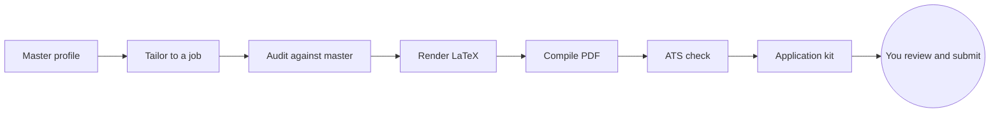

# cv-forge

cv-forge is a job-search copilot. It keeps one master profile of everything you have done, tailors an honest, ATS-safe LaTeX CV and cover letter for each real job posting, and prepares the application kit. You always click submit yourself.

## The problem

Searching for a job today means doing the same chores over and over:

- Reformatting your CV for every posting, then wondering whether an applicant tracking system (ATS) can even read the PDF.
- Writing for AI screening filters that reject candidates on keywords and layout quirks before a person looks at them.
- Retyping the same details into every application form.
- Spending time on ghost jobs: postings that are stale, never filled, or never meant to be.

cv-forge removes the mechanical part of this work and keeps the judgment with you.

## What works today (Phase 1)

Phase 1 is the foundation: from a master profile to a checked PDF.

- One master YAML profile holds every job, project, achievement and skill, with stable ids.
- A tailored selection picks which items to show for a given role. Text can be reworded for the target, but nothing outside the master profile can be invented.
- An audit step compares the tailored CV with the master and flags claims that drifted from the facts (numbers, titles, dates, skills).
- A LaTeX renderer produces a CV and a matching cover letter, in English, Brazilian Portuguese or European Portuguese.
- A compile step builds the PDFs, and an ATS check verifies the result: text layer extracts cleanly, dates and characters survive, layout checks catch orphaned headers, stranded section headings, large gaps and thin last pages.
- Privacy guards run as git hooks and in CI, so personal data stays out of the repository.

Commands:

```
cvforge validate <master>                      check a master profile against the schema
cvforge audit <tailored> --master <master>     compare a tailored CV with the master
cvforge build <tailored> --master <master>     audit, render, compile and ATS-check
cvforge master-cv <master> --lang en           render a full CV straight from the master
cvforge guard staged | msg <file>              privacy checks used by the hooks and CI
```

## Flow



## Roadmap

| Phase | Scope | Status |
| --- | --- | --- |
| 1 | Master profile, tailoring, audit, LaTeX CV and letter, ATS check, privacy guards, CI | Done |
| 2 | Job discovery from public sources, with a ghost-job filter to drop stale or fake postings | Planned |
| 3 | Salary estimates and drafted answers for common screening questions | Planned |
| 4 | Application kit per posting and a tracker for where each application stands | Planned |

## Quick start

Requires Python 3.10 or newer and a LaTeX setup (see below).

```bash
git clone <this repository> cv-forge && cd cv-forge
python3 -m venv .venv && source .venv/bin/activate
pip install -e '.[dev]'
git config core.hooksPath .githooks        # enable the privacy hooks

cvforge validate examples/persona/master.yaml
cvforge build examples/persona/tailored.yaml \
  --master examples/persona/master.yaml --out out/
```

`examples/persona` is a fictional candidate, "Ana Exemplo". The build writes a CV PDF and a cover letter PDF to `out/` and prints the result of the ATS check for each.

To use your own data, copy the persona files into `data/profile/` and edit them. That directory is ignored by git.

## LaTeX setup

The templates need LuaLaTeX for the CV and XeLaTeX for the letter, plus the `moderncv` class and `fontawesome5`.

- **Linux and CI:** install TeX Live.
  ```bash
  sudo apt-get install texlive-luatex texlive-xetex texlive-latex-extra \
    texlive-fonts-extra poppler-utils
  ```
  `poppler-utils` provides `pdftotext`, which the ATS check uses.
- **Windows:** install MiKTeX and run cv-forge from WSL. cv-forge calls the Windows engines, which can only write to Windows drives, so the build directory must be under `/mnt` (for example `/mnt/d/cv-forge-build`). Pass it with `--out` or set it in `cvforge.toml`, which is ignored by git.

## Privacy model

A CV repository is easy to leak from by accident, so privacy is enforced by tooling and not by habit.

- `data/` holds your real profile, tailored files and outputs. It is gitignored, and CI fails if any file under it is tracked.
- Git hooks in `.githooks` block commits that contain private paths, terms from a personal denylist derived from your profile, ID and phone number patterns, em dashes, or AI attribution in messages. `cvforge guard` runs the same checks in CI on every commit message.
- Secret scanning runs in CI with gitleaks.
- Everything public in this repository uses a fake persona and fake companies.

## You always click submit

cv-forge prepares material. It does not log in to job sites, fill in forms or send applications on your behalf. Every claim in a tailored CV is checked against your master profile, and every submission is a decision you make. A tool that applies in bulk produces noise for recruiters and risk for you; this one is built to help you apply to fewer, better-matched jobs.

## Credit and licence

cv-forge builds on [ai-job-search](https://github.com/ai-job-search-dev/ai-job-search) (MIT), whose LaTeX templates and ATS checks it adapts. Licensed under the MIT licence; see `LICENSE`.
